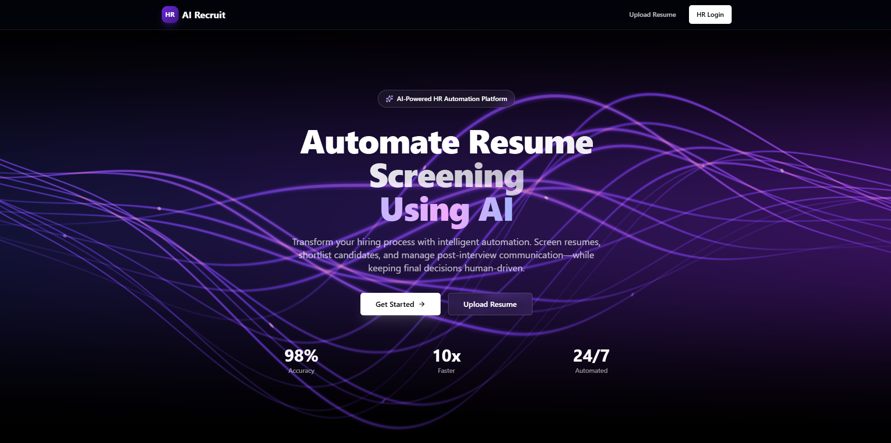

# AI Recruit: HR Automation Platform (Frontend)


An AI-assisted HR recruitment platform that screens resumes, ranks candidates, and automates post-interview communication, while keeping the final hiring decision with a human.

**🔗 Live demo:** https://hr-ai-recruit-two.vercel.app
**Demo login (HR dashboard):** `admin@company.com` / `admin123`


> **Status: frontend prototype.** The UI is complete and deployed, but it currently runs on **mock data**. The AI/RAG engine and backend API are being built by other team members (see [Backend integration](#backend-integration-planned)).

---

## Features

- **Landing page** with an animated WebGL shader background that fades as you scroll
- **AI Resume Screening** screen: job description, required keywords, minimum experience
- **Candidate ranking** with sorting (score, match rate, date, status) and status filters
- **Candidate list and detail pages** with AI strengths, areas for consideration, and a recommendation
- **Interview results form** that records score, feedback, and a final decision
- **Post-interview email automation tracker** for selection and rejection emails
- **Reports and analytics**: pipeline funnel, in-demand skills, weekly performance
- **Data storage overview** page
- **Candidate portal**: resume upload with file type and size validation
- **Human-in-the-loop by design:** AI recommends, HR decides

## Tech stack

| Area              | Tools                                                  |
| ----------------- | ------------------------------------------------------ |
| Framework         | React + Vite (JavaScript, `.jsx`)                      |
| Routing           | React Router                                           |
| Styling           | Tailwind CSS v3 with CSS-variable theming (dark theme) |
| UI components     | shadcn/ui-style components built on Radix UI           |
| Icons             | Lucide React                                           |
| Background effect | Custom WebGL fragment shader                           |
| Hosting           | Vercel                                                 |

## Getting started

**Prerequisites:** [Node.js](https://nodejs.org/) 18 or later and Git.

```bash
# 1. Clone the repository
git clone https://github.com/Sabhhzz/HR-AI-FrontEnd.git
cd HR-AI-FrontEnd
# 2. Install dependencies
npm install
# 3. Start the dev server
npm run dev
```

Open the URL printed in the terminal (usually `http://localhost:5173`).

### Scripts

| Command           | What it does                         |
| ----------------- | ------------------------------------ |
| `npm run dev`     | Start the development server         |
| `npm run build`   | Create a production build in `dist/` |
| `npm run preview` | Preview the production build locally |
| `npm run lint`    | Run ESLint                           |

### Troubleshooting (Windows)

If PowerShell says "running scripts is disabled", run this once:

```powershell
Set-ExecutionPolicy -Scope CurrentUser -ExecutionPolicy RemoteSigned
```

## Routes

| Route             | Access  | Page                                   |
| ----------------- | ------- | -------------------------------------- |
| `/`               | Public  | Landing page                           |
| `/login`          | Public  | HR login                               |
| `/upload`         | Public  | Candidate resume upload                |
| `/dashboard`      | HR only | Dashboard overview                     |
| `/ai-screening`   | HR only | Screening configuration                |
| `/ranking`        | HR only | Resume rankings                        |
| `/candidates`     | HR only | Candidate list                         |
| `/candidates/:id` | HR only | Candidate detail and interview results |
| `/automation`     | HR only | Email automation status                |
| `/reports`        | HR only | Reports and analytics                  |
| `/data-storage`   | HR only | Data storage and management            |
| `*`               | Public  | 404 page                               |

## Project structure

```
src/
├── components/
│   ├── ui/                  # Reusable UI components (button, card, input, ...)
│   └── ProtectedRoute.jsx   # Redirects to /login when not signed in
├── lib/
│   └── utils.js             # cn() className helper
├── pages/                   # One file per route
├── App.jsx                  # Route definitions
├── main.jsx                 # App entry point
└── index.css                # Tailwind layers + theme variables
```

## Backend integration (planned)

The pages currently read hardcoded mock data. When the backend is ready, each page should switch to API calls. A suggested contract:

| Method | Endpoint                        | Used by             |
| ------ | ------------------------------- | ------------------- |
| `POST` | `/api/auth/login`               | Login               |
| `POST` | `/api/resumes`                  | Candidate upload    |
| `POST` | `/api/screening/run`            | AI screening        |
| `GET`  | `/api/candidates`               | Candidates, Ranking |
| `GET`  | `/api/candidates/:id`           | Candidate detail    |
| `PUT`  | `/api/candidates/:id/interview` | Interview results   |
| `GET`  | `/api/automation/emails`        | Automation tracker  |
| `GET`  | `/api/reports`                  | Reports             |

Candidate object the UI expects:

```json
{
  "id": 1,
  "name": "string",
  "email": "string",
  "score": 0,
  "status": "Shortlisted | Pending | Rejected | Selected",
  "strengths": ["string"],
  "weaknesses": ["string"],
  "recommendation": "Shortlist | Reject",
  "appliedDate": "YYYY-MM-DD"
}
```

Configure the API base URL with an environment variable. Only non-secret values belong in `VITE_` variables, because they are bundled into public JavaScript:

```bash
# .env  (never commit this file)
VITE_API_BASE_URL=http://localhost:8000
```

## Security notes

This is a prototype, so the protections are intentionally limited:

- **Authentication is a demo.** The login checks hardcoded credentials and stores a flag in `localStorage`. Real authentication (hashed passwords, httpOnly cookies or JWTs, rate limiting, server-side roles) must be implemented in the backend.
- **Client-side checks are not enforcement.** Route protection and form validation improve UX and block casual misuse, but the backend must re-validate everything, including authorization on each request.
- **Uploads:** the resume form validates file type and size in the browser. In this demo, files are not uploaded or stored anywhere.
- **No secrets in the repo.** API keys (for example, Gemini/OpenAI) must live only in the backend environment, never in frontend code or `VITE_` variables.
- **Security headers** (`X-Frame-Options`, `X-Content-Type-Options`, `Referrer-Policy`, `Permissions-Policy`) are set in `vercel.json`.
- **AI safety:** resumes are untrusted input to the LLM. The AI layer should treat resume text as data, validate structured output, and never trigger emails or status changes on its own.

## Deployment

Deployed on [Vercel](https://vercel.com). Every push to `main` redeploys automatically. `vercel.json` rewrites all routes to `index.html` so React Router deep links work on refresh.

## Team

| Role                 | Contributor                             |
| -------------------- | --------------------------------------- |
| Frontend Developer   | [@Sabhhzz](https://github.com/Sabhhzz)  |
| AI and RAG Developer | [@Nithin](https://github.com/NithinR06) |
| Backend Developer    | [@Ayman](https://github.com/iimoon)     |

## Roadmap

- [ ] Connect the frontend to the backend API
- [ ] Replace demo authentication with real auth
- [ ] Integrate the AI/RAG resume screening engine
- [ ] Real resume upload and parsing
- [ ] Automated email delivery
- [ ] Content-Security-Policy header once the backend URL is final
